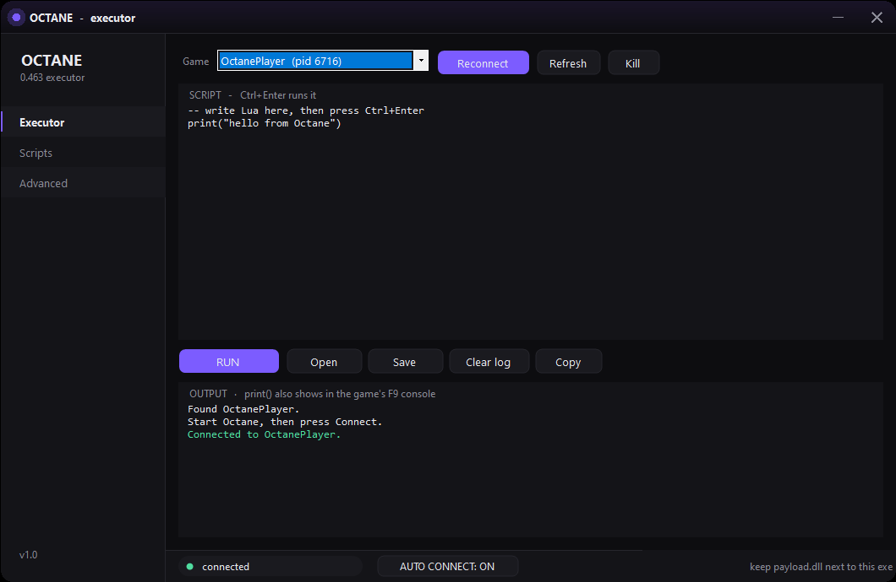

# octane-0463 tooling

Reverse-engineering and instrumentation tooling for a Windows x86 Roblox client
build (`OctanePlayer.exe` 0.463.0.417004, 2021-01-22). Source-only.



## Status

**Done**

- [x] x86 + x64 DLL injector (architecture-checked, `VirtualFreeEx` on the path buffer)
- [x] Inline hook engine (6-byte x86 / 14-byte x64) with register-saving stub
- [x] Prologue decoder: auto-aligns patch length, refuses relative branches
- [x] `lua_State` capture via `lua_gettop` hook; full line protocol over a named pipe
- [x] WinForms GUI: auto inject/attach, editor, batched log, script list
- [x] Verified offsets for this build (`gettop`, `pcall`, `luaD_pcall`, `luau_load`, `tolstring`)
- [x] `luaS_newlstr` (`0x1356DB0`) and `lua_pushlstring` (`0xF41C80`) identified

**Not done**

- [ ] **Script execution** — bytecode accepted, `lua_pcall` faults at `EIP=0`
- [ ] `lua_State` / `CallInfo` layout for this build (the published `ci` offset is wrong)
- [ ] Globals-table access → `loadstring` (Luau has no `LUA_GLOBALSINDEX`)
- [ ] x64 path tested end-to-end against a real 64-bit client
- [ ] Automatic offset discovery for other client builds (`payload.cfg` is manual)
- [ ] Lua 5.1 revivals wired up (would not need the 0.501 compiler at all)

## What works

- **Injector** — `LoadLibraryW` via remote thread, refusing architecture mismatch.
- **Hook engine** — detours with a runtime stub that saves/restores the volatile set,
  plus a trampoline built from the original prologue.
- **Lua bridge** — hooks `lua_gettop`, captures the state, resolves the four needed
  functions from config, exposes `PING / INIT / STATUS / STATE / HITS / LOG / EXEC /
  BC / PROBE / LOADTEST / STRUCT / FIELD / HOOK / UNHOOK / PROLOGUE / OPT`.
- **GUI** — borderless dark shell, auto connect, kill, animated nav, batching log.

## What does not work

**Script execution.** The executor compiles Lua with a vendored **Luau 0.501**
compiler; `luau_load` accepts the bytecode and builds a real closure, but
`lua_pcall` then faults with `0xC0000005` at `EIP = 0`.

The client is a **January-2021** build. Its `Proto` layout and opcode enum differ
from 0.501, and Luau does not bump `LBC_VERSION` for enum changes, so the loader
cannot detect the mismatch. No public Luau source exists for that date — the
upstream repository was documentation-only then, and its oldest tag is 0.501.

`STATUS.md` has the full investigation, everything ruled out, and the two
remaining branches.

## Layout

```
src/injector/       injector executable
src/payload/        payload: hooks, prologue decoder, Lua bridge, pipe server
ui/src/             GUI source (C# 5 / WinForms, no designer)
tools/              pefind (PE scanner), build scripts
tests/              hook, lua-bridge, compiler and prologue self-tests
third_party/luau/   Luau 0.501 compiler (MIT, (c) Roblox Corporation)
STATUS.md           full technical status / handoff
octane-offsets.md   original offset notes (partly superseded — see STATUS.md)
```

## Build

Needs Visual Studio 2022 C++ tools.

```
build.bat                                  # both architectures
cmake --build build32 --config Release
powershell -File tools\build-ui.ps1        # GUI
```

## Notes

- Offsets live in `payload.cfg` (see `payload.cfg.example`); nothing is hardcoded.
- The payload makes no network calls and installs no persistence.
- Third-party exploit payloads used during research are **not** in this repository.
- Prebuilt binaries are attached to the release, not committed.

## Licence

MIT — see `LICENSE`. `third_party/luau` is Luau, MIT licensed, (c) Roblox Corporation.
